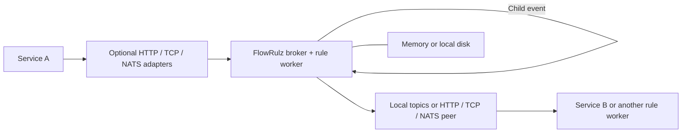

# Worker-hosted broker

Both Go and Rust expose protocol v1 in `WORKER_MODE=broker`. See the
[Rust worker guide](rust-worker.md) for its startup command, supported local-rule
subset and recovery checks. The transport matrix is exercised in both runtime
directions; this evidence covers the sample chain and broker protocol, not full
rule-language or distributed-failover equivalence.

`WORKER_MODE=broker` runs the message broker and local rule evaluator inside one
FlowRulz worker process. HTTP, framed TCP and NATS request/reply are optional
adapters around the same broker operations. Producers publish directly to FlowRulz
and destination services consume directly from it. Outputs can stay in the local
broker or be forwarded through one selected peer transport.



## Start and use

From the repository root:

```sh
WORKER_MODE=broker \
WORKER_RULES_DIR=examples/direct-worker/rules \
NUM_SHARDS=16 \
go run ./cmd/worker
```

The default HTTP listener is `127.0.0.1:8090`. This command starts the complete
local data path in one process.

## Optional transports

`BROKER_TRANSPORTS` selects any comma-separated combination of `http,tcp,nats`.
Use `none` to start only the in-process core. Disabled adapters do not create
listeners or connections and their addresses are not required. NATS requires an
external NATS server only when NATS ingress or output is selected.

```sh
# TCP ingress with locally retained outputs
WORKER_MODE=broker WORKER_RULES_DIR=examples/direct-worker/rules \
  BROKER_TRANSPORTS=tcp BROKER_TCP_ADDR=127.0.0.1:8091 go run ./cmd/worker

# HTTP and TCP clients share one broker and its consumer offsets
WORKER_MODE=broker WORKER_RULES_DIR=examples/direct-worker/rules \
  BROKER_TRANSPORTS=http,tcp go run ./cmd/worker

# NATS request/reply ingress
WORKER_MODE=broker WORKER_RULES_DIR=examples/direct-worker/rules \
  BROKER_TRANSPORTS=nats NATS_URL=nats://127.0.0.1:4222 \
  BROKER_NATS_SUBJECT=flowrulz.broker.a go run ./cmd/worker

# Embedded use with no network ingress
WORKER_MODE=broker WORKER_RULES_DIR=examples/direct-worker/rules \
  BROKER_TRANSPORTS=none go run ./cmd/worker
```

In-process callers within the server module use `services/broker.Service.Execute`
or the runtime broker methods. A standalone `none` process waits for shutdown
with its rule worker ready. Embedding code supplies its own in-process producers.

`BROKER_OUTPUT_TRANSPORT` independently selects `local` (default), `http`, `tcp`
or `nats`. Remote output forwards all actions, including child events, to one
peer implementing the shared broker protocol. That peer stores incoming messages
and can run its own local rules. HTTP/TCP forwarding uses that peer's FlowRulz
protocol, and NATS forwarding uses its broker-specific RPC subject.

For HTTP ingress on worker A and TCP forwarding to worker B:

```sh
# Start B first; it evaluates forwarded child events and retains final commands.
WORKER_MODE=broker WORKER_RULES_DIR=examples/direct-worker/rules \
  BROKER_TRANSPORTS=tcp BROKER_TCP_ADDR=127.0.0.1:8093 go run ./cmd/worker

# Start A in another terminal.
WORKER_MODE=broker WORKER_RULES_DIR=examples/direct-worker/rules \
  BROKER_TRANSPORTS=http BROKER_OUTPUT_TRANSPORT=tcp \
  BROKER_OUTPUT_ADDR=127.0.0.1:8093 go run ./cmd/worker
```

HTTP peers use `BROKER_OUTPUT_URL=http://host:port`. TCP peers use
`BROKER_OUTPUT_ADDR=host:port`. NATS peers use `BROKER_OUTPUT_NATS_URL` (defaults
to `NATS_URL`) and `BROKER_OUTPUT_NATS_SUBJECT`. Set `BROKER_OUTPUT_TOKEN` to
the peer's token. A peer acceptance confirms storage there, independently of its
subsequent rule execution. Ambiguous responses remain retryable and can duplicate
outputs. Each broker keeps its own local consumer offsets and storage.

## Shared request/response protocol

TCP and NATS use the same versioned JSON requests. HTTP also exposes them at
`POST /v1/broker/rpc`; the resource-oriented HTTP endpoints below remain supported.

```json
{"version":1,"id":"request-1","operation":"consume","tenant_id":"demo","token":"optional-token","topic":"commands.b.handle","group":"service-b","wait_ms":20000}
```

Responses contain `version`, the echoed `id`, `code`, and optional `data`.
Result codes include `accepted`, `message`, `empty`, `ok`, `invalid`,
`unauthorized`, `forbidden`, `conflict`, and `unavailable`. `publish` carries an
`event` using the canonical envelope. `append` carries `topic`, `key`, and JSON
`payload`. Appending to `events` applies the same event validation and tenant
checks as publication. `consume`, `ack`, and `retry` use the fields shown in the
HTTP examples below. Invalid versions and trailing JSON documents are rejected.

TCP frames consist of a four-byte unsigned big-endian JSON byte length followed
by the JSON bytes. Requests are capped at 1 MiB, responses at 2 MiB. A connection
supports sequential requests and is reusable. Each server bounds connections at
64, closes idle reads after 30 seconds and cancels outstanding operations during
shutdown. TCP is this FlowRulz protocol rather than the Kafka wire protocol.

NATS clients send a request/reply message to `BROKER_NATS_SUBJECT`. Give each
independent broker instance a unique subject. Fire-and-forget messages on this
RPC subject are ignored. Requests are capped at 1 MiB and the NATS server's
`max_payload` must also accommodate responses. A response beyond that configured
limit returns `too_large`; use HTTP/TCP or increase the NATS server limit for
large records. Subscription queues and active request handling are bounded.

The repository includes a client for every network adapter. For example:

```sh
printf '%s' '{"operation":"consume","topic":"commands.b.handle","group":"service-b","wait_ms":20000}' | \
  go run ./examples/broker-client -transport tcp -address 127.0.0.1:8093 -tenant demo
```

Use `-transport http -address http://127.0.0.1:8090`, or
`-transport nats -address nats://127.0.0.1:4222 -subject flowrulz.broker.a`.
The example reads its token from `BROKER_TOKEN`. It prints the versioned response,
including the receipt needed for a subsequent ACK request.

Publish an event using the existing canonical EventEnvelope. Runtime identity
belongs under `meta`.

```sh
curl --fail-with-body http://127.0.0.1:8090/v1/broker/events \
  -H 'Content-Type: application/json' -H 'X-Tenant-ID: demo' \
  -d '{"id":"demo-1","type":"a.created","occurred_at":"2026-11-12T12:00:00Z","meta":{"tenant_id":"demo","partition_key":"order-1"},"data":{"id":"order-1"}}'
```

Acceptance returns HTTP 202 with topic, partition and offset. It confirms broker
acceptance. Rule processing follows asynchronously. The included rules transform
`a.created` into `a.processed`, then publish a command to `commands.b.handle`.

Service B fetches one delivery with a bounded long poll:

```sh
curl --fail-with-body http://127.0.0.1:8090/v1/broker/consume \
  -H 'Content-Type: application/json' -H 'X-Tenant-ID: demo' \
  -d '{"topic":"commands.b.handle","group":"service-b","wait_ms":20000}'
```

The response contains `record`, `group`, `receipt`, and `expires_at`.
`record.payload` is the existing Effect JSON object for command/generic effects
and the existing EventEnvelope for the `events` topic. After handling the command,
ACK using the returned partition and receipt:

```sh
curl --fail-with-body http://127.0.0.1:8090/v1/broker/ack \
  -H 'Content-Type: application/json' -H 'X-Tenant-ID: demo' \
  -d '{"topic":"commands.b.handle","group":"service-b","partition":0,"receipt":"COPY_RECEIPT_FROM_CONSUME"}'
```

Replace `partition` as well as `receipt` with the consumed values. ACK returns
HTTP 204. An expired or superseded receipt returns HTTP 409. To request redelivery,
use `/v1/broker/retry` with the same fields and optional `delay_ms` (0–300000).

## Configuration

| Setting | Default and meaning |
|---|---|
| `WORKER_MODE` | Set `broker` to host the broker |
| `WORKER_RULES_DIR` | Required local JSON rule directory |
| `NUM_SHARDS` | 4096; sets the fixed partition count, range 1–4096 |
| `BROKER_ADDR` | `127.0.0.1:8090` |
| `BROKER_TRANSPORTS` | `http`; any subset of `http,tcp,nats`, or `none` |
| `BROKER_TCP_ADDR` | `127.0.0.1:8091` |
| `BROKER_NATS_SUBJECT` | `flowrulz.broker`; use a unique literal subject per broker |
| `BROKER_OUTPUT_TRANSPORT` | `local`, `http`, `tcp` or `nats` |
| `BROKER_OUTPUT_URL` | HTTP peer base URL when HTTP output is selected |
| `BROKER_OUTPUT_ADDR` | TCP peer address when TCP output is selected |
| `BROKER_OUTPUT_NATS_URL` | NATS output URL, falls back to `NATS_URL` |
| `BROKER_OUTPUT_NATS_SUBJECT` | `flowrulz.broker`; peer's RPC subject |
| `BROKER_OUTPUT_TOKEN` | Peer's shared client token |
| `BROKER_STORAGE` | `memory` or `file`, default `memory` |
| `BROKER_DATA_DIR` | `data/broker`, used with file storage |
| `BROKER_TOKEN` | Optional bearer token on loopback; minimum 16 characters for other bindings |
| `BROKER_MAX_MESSAGES` | 10000 retained records across all topics, range 2–10000 |
| `BROKER_MAX_BYTES` | 67108864 payload bytes across all topics, maximum 64 MiB |
| `BROKER_ACK_WAIT_MS` | 30000; range 100–300000 |
| `EVENT_RETRY_DELAY_MS` | 5000 after rule failure |

Memory mode keeps messages and consumer offsets in the process. File mode saves
messages and committed offsets in atomic, synced snapshots. Enable it with
`BROKER_STORAGE=file BROKER_DATA_DIR=/path/to/local/data`. Its directory uses an
exclusive process lock. Keep the same partition count on reopening stored data.
The file adapter targets Linux and macOS local filesystems.

For authenticated HTTP resource endpoints, clients send
`Authorization: Bearer <BROKER_TOKEN>`. Shared RPC requests carry `token` and
`tenant_id` in the request body across HTTP, TCP and NATS.
The token authenticates trusted applications that may assert tenant identity.
The HTTP header or RPC tenant field scopes reads, groups and ACKs and must match
the event's tenant. This shared token is not a per-user authorization system. Use a trusted
gateway with TLS and tenant authorization for untrusted network callers.

## Message and failure behavior

- Topics are named retained logs. Existing rule routing produces `events`,
  `commands.<destination>.<name>`, and `effects.<topic>`.
- The existing tenant/partition-key function selects the partition. Offsets
  increase independently in each topic partition and remain stable after cleanup.
- Consumers sharing tenant, topic and group compete for deliveries. Each partition
  has one outstanding receipt per group. Separate groups consume independent copies.
- New groups start at the earliest retained record. ACK advances that group's
  partition offset. Unacknowledged messages become claimable after ACK timeout.
- Capacity pressure reclaims only partition prefixes acknowledged by every
  registered matching group. Outputs without a subscriber remain retained.
  New groups cannot replay reclaimed data. Slow groups can hold retention.
- Producers receive HTTP 503 under capacity pressure. External input reserves a
  quarter of configured capacity for rule outputs. No unconsumed prefix is
  discarded to accept a new input.
- Rules run sequentially in the hosted worker and outputs become available
  immediately after append. Long polls wake on publication. Outputs are appended
  before input ACK. Partial failures and restart can repeat outputs, so receivers
  honor existing stable idempotency keys. No latency benchmark is claimed.
- Malformed envelopes and contract-bound inputs are rejected at HTTP ingress.
  Unknown rulesets remain retryable. Local rules support `emit`, `command`, and
  `emit_event`. Scheduler and registry-bound contract features require the
  existing durable runtime.
- File-save failure stops further acceptance and delivery until restart. A client
  with an uncertain HTTP result may retry and create duplicate log records.

This implementation is a single broker instance with bounded storage. Cluster
replication, automatic failover, remote partition rebalancing, and Kafka wire
compatibility are not implemented. A broker disk snapshot is rewritten for durable
mutations, so file-mode write cost grows with retained state. Memory mode avoids
that disk work and loses state when the process exits.

## Ownership and verification

The composition root is `cmd/worker/broker.go`. Broker policy, offsets, capacity
and receipt fencing belong to `internal/runtime/broker`. The local file adapter
is `internal/adapters/brokerstore`. HTTP translation belongs to
`internal/adapters/http/broker`, framed TCP belongs to `internal/adapters/tcp`,
and optional NATS RPC belongs to `internal/adapters/nats/broker.go`.
`internal/services/broker` applies common operation/authentication policy using
the protocol contract in `internal/ports/broker_protocol.go`.
`internal/adapters/embedded` connects the existing rule/effect interfaces to
local broker operations. `internal/adapters/remote` publishes through a selected
peer client. Adapter composition and lifecycle are in
`cmd/worker/broker_transports.go`. The existing evaluator,
canonical envelopes, effect representation, and shard function are reused.

The implementation uses an internal storage interface so another persistence
adapter can be added without moving delivery policy into storage. Local snapshots
were selected to avoid a new database dependency. A segmented write-ahead log is
a future performance change requiring separate recovery and corruption tests.

Regression tests cover partition order, consumer groups, tenant isolation, retry
delay, stale receipts, bounded retention, failure to persist, and process-exit
recovery with a local file. Integration tests run the full two-rule chain through
real HTTP connections with memory and file storage. A separate integration matrix covers
in-process, HTTP and TCP ingress with local/HTTP/TCP outputs. Docker-backed E2E
tests cover all nine HTTP/TCP/NATS ingress-to-peer-output combinations, including
child-event processing, consumer ACKs and cross-tenant ACK rejection. Stop clients
and the broker before reverting deployment configuration. Keep snapshots for recovery, and
expect duplicate handling when replaying inputs into another runtime.
