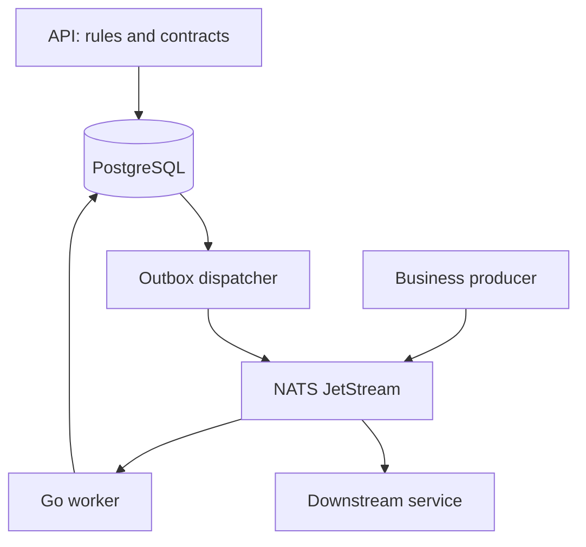

# FlowRulz architecture and business-fit review

Reviewed PR #35 at `a4395b4` and its surrounding repository. This report describes the durable Go path unless a different mode is named. Code, tests, and migration history take precedence over earlier design proposals.

## Purpose and fitness

FlowRulz lets engineers register versioned rules that turn an incoming business event into decisions and asynchronous effects. For example, an `order.created` event can match a fraud ruleset and a payment ruleset, record their decisions, and enqueue downstream work. The same runtime can serve banking, retail, or other domains without hard-coding each domain's policy into the worker.

The current design is a useful foundation for an engineering-managed event rules platform. It is not yet a verified multi-tenant, self-service production product or a general workflow engine. Correlated wait/resume, automatic service deployment reconciliation, end-to-end ordering, and exactly-once external effects are not established. Business users still need an operating model for authoring, approving, testing, rolling back, and auditing policy changes.

## Current high-level design



The API is the control plane. Producers publish events directly to NATS; the worker evaluates rules. Within the durable transaction, the worker asserts the shard lease, deduplicates by tenant/event/ruleset, records executions and outbox intents, then commits before acknowledging the input. Outbox delivery is at-least-once; receiver idempotency is required. `direct` and worker-hosted `broker` modes have different persistence and recovery guarantees; do not apply this diagram's database guarantees to them.

## DDD boundaries

These are responsibility boundaries in one codebase, not claims that separately deployed bounded contexts already exist.

| Responsibility | Model / owning code | Boundary to protect |
|---|---|---|
| Policy configuration | Domain, Service assignment, Contract, RuleRevision and Activation; `internal/services/rules`, `internal/services/domainservices` | Configuration is global; it is not a runtime tenant identity. Revision immutability and activation need explicit audit/approval policy. |
| Event decision | EventEnvelope, inbox, rules evaluator, Execution; `internal/services/events`, `internal/rules` | Each execution belongs to a tenant, event and ruleset; evaluation must not perform external I/O. |
| Delivery | Outbox effect, subscription and scheduler; `internal/services/effects`, `internal/runtime/scheduler` | A decision commits an intent; receiver completion is a separate outcome. Subscription is not an execution Service. |
| Runtime coordination | Shard lease/fencing, key queue and broker adapters | Transport and storage mechanics must not dictate business policy; runtime ownership does not authenticate a producer. |

`Domain` is a configured business namespace; `Service` means an execution deployment, while `DomainService` is also used for subscriber registration. The overlapping terminology increases confusion. Rename only with an explicit API/data compatibility plan; do not assume a package rename creates a bounded context.

## Prioritized findings

| Priority | Finding and evidence | State / next step |
|---|---|---|
| P0 | A single event can match several contract bindings. Inbox lookups previously selected an arbitrary ruleset and PostgreSQL committed every row for that tenant/event, overwriting execution associations. Mongo also committed without a ruleset filter. | This change scopes lookup and commit to the ruleset, validates duplicate ownership, and adds regression tests. Live PostgreSQL/Mongo recovery and previously corrupted records still need verification. |
| P0 | Migration startup used a transaction-scoped advisory lock in an autocommitted pool operation, so the lock did not protect the migration run. | This change uses one session lock for initialization and every migration transaction, and adds an infrastructure-backed concurrency test. |
| P0 | Stored Service assignments are not used by the event resolver, and workers still acquire globally shared shards. Previously a mismatched target could be quarantined and ACKed. | Deployment identity now fails startup and targeted events are retried; isolated routing and pinned-revision enforcement are still unimplemented. |
| P0 | A resource-specific JWT admin scope previously authorized unrelated global configuration routes. A proxy token alone also granted global access. | Global routes now check the corresponding scope and authenticated proxy assertions; complete tenant/resource and broker authorization remain to be verified. |
| P1 | Authenticated API deployments rejected unauthenticated health/readiness probes even though Compose and Kubernetes use them. | This change exposes only GET probes without credentials, while readiness fails if required authentication is not configured. API readiness checks the database, not NATS or worker progress. |
| P1 | PR #35 added a 15-line function rule including tests and generated code. On `a4395b4`, Go CI reported 475 function-length issues. | Use a 100-line/80-statement coarse production guard, exempt test functions, and split the largest worker and checkpoint operations at meaningful boundaries. All other linters remain enabled. |
| P1 | Fixed replica-count lease targets and process-local key serialization do not establish ordered execution across redelivery, handoff, or outbox publishers. | Keep `WORKER_REPLICAS` consistent; test lease loss, replay and ordering before promising those properties. |
| P1 | In-memory contract/integration tests cannot prove SQL or Mongo transaction behavior, ACK loss, or failover. | Run live adapter conformance and failure-injection suites for the deployed backends. Rust PostgreSQL parity remains experimental. |
| P2 | The single event-trace view uses an inbox lookup by tenant/event and can show only one of several ruleset executions. | Add a paginated multi-execution trace with a compatibility plan; do not describe the current view as a complete fan-out trace. |

## Inbox upgrade and operations

Migration `025` fills an empty historical ruleset only when its referenced execution has the same tenant and event and names a nonempty ruleset. Rows with no authoritative match or a conflicting existing key remain unresolved. The Go worker refuses to re-execute an event when such an empty ruleset row exists; the experimental Rust durable path also refuses a new insert in this case. Mongo legacy documents with a missing or empty ruleset likewise fail closed and need operator reconciliation.

For an existing installation, stop event consumption during rollout, back up state, apply migrations, and start the updated workers together. Do not run old and new workers concurrently: older code can still overwrite ruleset execution links. This rollout does not automatically repair entries already associated with an incorrect execution. Inspect mismatches and unresolved rows using the authoritative business history before taking recovery action:

```sql
SELECT i.tenant_id, i.event_id, i.rule_set, i.status, i.execution_id,
       e.tenant_id AS execution_tenant, e.event_id AS execution_event,
       e.rule_set AS execution_ruleset
FROM inbox i
LEFT JOIN executions e ON e.execution_id = i.execution_id
WHERE i.rule_set = '' OR
      (i.status = 'committed' AND
       (e.execution_id IS NULL OR e.tenant_id <> i.tenant_id OR
        e.event_id <> i.event_id OR e.rule_set <> i.rule_set));
```

Do not blindly rewrite or replay mismatched rows: outbox delivery may already have happened. Investigate each event and receiver idempotency history first.

## Suggested order of work

1. Prove the inbox and migration fixes against real PostgreSQL and MongoDB, including upgrade, duplicate delivery, crash and stale-owner cases.
2. Define and implement service-scoped routing and assigned-revision enforcement; keep the existing global configuration model distinct from tenant data.
3. Complete authorization and cross-tenant negative tests, then run a security review of broker and management endpoints.
4. Define product requirements for rule approval, explainability, replay and rollback; use one business flow to validate them before expanding modes.
5. Keep function decomposition tied to responsibility and preserve failure-path coverage rather than mechanically splitting cohesive logic.
